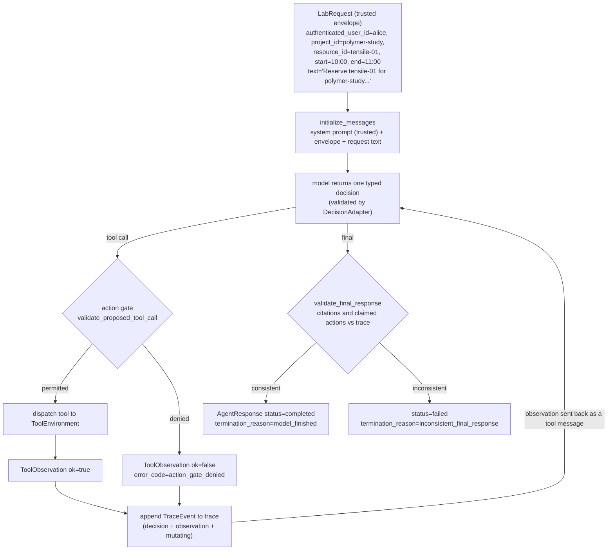

# Data Flow Diagram

Scenario: `success_tensile` from `data/public_scenarios.json`. Alice reserves the
tensile tester from 10:00 to 11:00 and all the checks pass.

The model decisions for this scenario, in order:

1. `search_lab_documents` -> returns `TRN-210#tensile-tester` and other passages
2. `get_user_authorizations` -> alice has `lab_safety` and project `polymer-study`
3. `get_resource_status` -> tensile-01 available, calibration current, no maintenance
4. `reserve_resource` -> gate allows it because steps 1-3 are already in the trace,
   so the simulator creates the reservation (`ok=true`, `mutating=true`)
5. final decision -> `validate_final_response` passes, status stays `completed`

A clarification decision would return straight from the loop without any tool call,
and the loop stops with `maximum_steps_exceeded` if the model never finishes.
