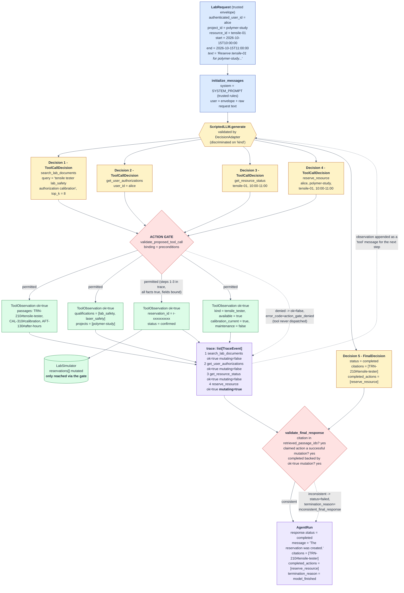

# Data Flow Diagram

Scenario `success_tensile` from `data/public_scenarios.json`, traced through the
completed system. Alice asks to reserve the tensile tester for an hour; every
required check passes and the reservation is created.

**Reading the diagram.** Blue is trusted input, yellow is model-proposed and
therefore untrusted, red is application-owned validation, green is observed
fact, purple is the authoritative record. The model never reaches the simulator
directly: every proposal passes through the action gate, and the gate is what
decides whether `reserve_resource` is dispatched. Dashed edges are the paths
taken when a check fails. Note that steps 1-3 are not merely informative — the
gate reads them back out of the trace, so the reservation in step 4 is only
permitted because those three observations are already recorded.
